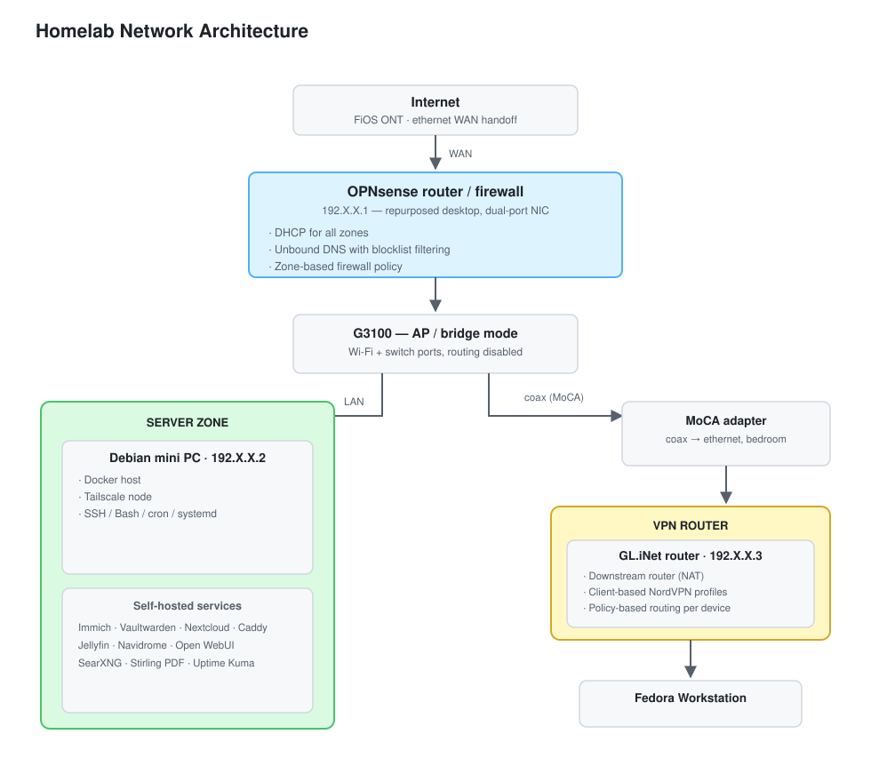

# Homelab Network & Service Infrastructure

A self-hosted network and service platform I designed, built, and operate on repurposed
hardware. This repository documents the **architecture and the design decisions** behind
it — not the running configuration.

Everything here runs continuously: a segmented home network with a dedicated firewall,
20 containers across 9 Compose stacks, a private certificate authority, and remote access
over a mesh VPN.

---

## Architecture



**Shape of the network:** the ISP handoff terminates at a dedicated OPNsense
router/firewall, which owns DHCP, DNS, and the zone policy. The ISP gateway is demoted
to access-point/bridge mode. Behind it sits a server zone (the Docker host), a client
zone, and a separate egress zone reached over the building's existing coax via a MoCA
bridge — where a downstream router applies per-device VPN policy.

Full reasoning for each layer is in
[`docs/design-decisions.md`](docs/design-decisions.md).

## Stack

| Service | Role | Notes |
|---|---|---|
| **OPNsense** | Router / firewall | Zone segmentation, DHCP, Unbound DNS with blocklists |
| **Caddy** | Reverse proxy | TLS for every service via an internal certificate authority |
| **Tailscale** | Remote access | Off-LAN access without exposing any inbound port |
| **Immich** | Photo & video backup | 4 containers: server, ML inference, Valkey, PostgreSQL |
| **Vaultwarden** | Password manager | Self-hosted; requires HTTPS for the web vault's Web Crypto API |
| **Nextcloud** | File sync | MariaDB + Redis backing services |
| **Jellyfin / Navidrome** | Media | `/dev/dri` passthrough for hardware transcoding |
| **Open WebUI** | Local LLM front end | Talks to Ollama; per-model workspaces |
| **SearXNG** | Search | Self-hosted metasearch |
| **Stirling PDF** | Document tooling | Local PDF manipulation |
| **Uptime Kuma** | Monitoring | Availability checks across the stack |
| **GL.iNet + NordVPN** | Policy-routed segment | Per-device egress selection |

## Design highlights

1. **Zone segmentation over a flat network.** Servers, clients, and a policy-routed
   segment sit behind distinct firewall policies rather than one trust domain.
2. **Local DNS with blocklist filtering.** Resolution stays on-network; no third-party
   resolver sees the query log.
3. **TLS everywhere, including internal services.** A private CA issues certificates for
   services that never touch the public internet.
4. **Reusing existing coax for a second network segment.** A MoCA bridge extends the
   LAN to a physically distant room without running new cable.
5. **Per-device egress selection.** Client-side policy routing sends chosen devices
   through a VPN tunnel while leaving the rest direct.

## What is deliberately not in this repository

Secrets, credentials, private keys, firewall rule exports, and live host configuration.
The templates under [`examples/`](examples/) are sanitized: every credential is
externalized to an environment variable and every address uses RFC 5737 documentation
ranges (`192.0.2.0/24`).

`.gitignore` excludes `.env` files, private keys, database dumps, and application data.
Before the initial commit, secret scanning (`gitleaks`) was run over the live
configuration to build that exclusion list — it identified a private key and a database
dump containing a VPN key, which is why the patterns are as broad as they are.

## Repository layout

```
.
├── README.md
├── docs/
│   ├── architecture.svg      rendered network diagram
│   └── design-decisions.md   the "why" behind each choice
└── examples/                 sanitized Compose templates
    ├── open-webui/
    ├── vaultwarden/
    └── immich/
```
